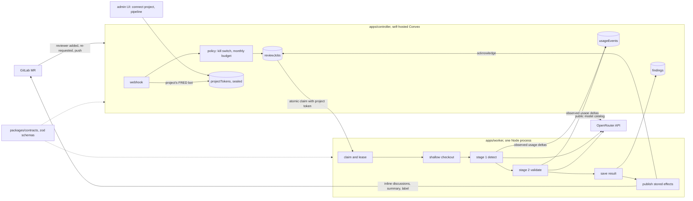

# AI review service

Each GitLab project reviews merge requests through its own FRED bot: the bot user of the project's `0 FRED` project access token. The retired shared Claude and Codex accounts stay in the data as history.

The decisions behind the design are in `docs/architecture.html`. The facts the code must match, meaning triggers, policy order, job statuses, finding shape, MR output, data model, and environment variables, are in `docs/reference.html`. Read the reference before changing anything the tables in it describe, and update the table in the same change.

## The four ways to hurt yourself

1. **Touching Convex Cloud.** Convex is self-hosted only. Never run `convex dev` or `convex deploy` against Convex Cloud, never call `convex login`. The CLI is configured through `CONVEX_SELF_HOSTED_URL` and `CONVEX_SELF_HOSTED_ADMIN_KEY`.
2. **Leaking the network.** External service traffic is limited to OpenRouter model requests and public model discovery. Controller, worker, GitLab, and development tunnels stay on company infrastructure.
3. **Posting on a real MR.** A worker claiming from a controller with connected projects posts as their FRED bots. A dev worker points at a Convex deployment on your own machine and a fixture MR, never at the shared deployment.
4. **Spending real budget from a test.** Tiers one and two use fixtures and fake transports. Agents may run `pnpm fred dev verify --live openrouter` in the isolated local Docker environment. Other live runs require a human and `AI_REVIEW_LIVE=1`.

## Rules the code does not confess

- The review agent gets controlled reads and searches over its checkout, including repo skill discovery and loading. Shell, writes, network tools, host files outside the checkout, and worker credentials are unavailable. The worker holds the claimed project token and posts on the agent's behalf.
- There is no per-review dollar cap and no ignore list, by decision. Do not add either. Each model stage has a 45-minute timeout. There is no model-call or tool-call count limit.
- The bot never approves an MR and never sets a blocking status. It comments and sets labels.
- Every denial and every failure posts one comment on the MR.
- Model and effort choices come from OpenRouter's public catalog through its official SDK. The admin selects them per project and stage as the project's review pipeline. Bot identity controls GitLab ownership, labels, and policy, not model vendor. Validate saved pipelines against catalog capabilities. Snapshot the pipeline when enqueueing; workers use the job snapshot through completion and validate its selection schema before analysis.
- GitLab project access tokens live sealed in the controller's `projectTokens`, never in env files. Only `projectTokens.ts` opens them, for the worker claim, MR notes, command verification, and token checks; admin functions return metadata only. A project without a usable token is not connected and triggers nothing.
- FRED supports GitLab only, by decision. Do not add a forge abstraction or an adapter for GitHub or another forge. Keep GitLab API calls in the worker's `gitlab` module and the controller's `gitlab*.ts` files. See `docs/architecture.html#decisions`.
- New work is always provider `fred`. `claude` and `codex` are retired: keep their history readable, never trigger them, and refuse commands on their findings.
- Store validated findings and immutable publication effects before the first GitLab write. Preserve every finding status, including pending and validator rejects. Never delete them.
- Transcripts contain source code. Serve them only through the admin-authenticated download action, never a `ctx.storage.getUrl` link, and keep them out of the journal and diagnostics.
- Root `REVIEW.md` supplies project review rules and can reference any repo skill. Missing rules or skills add a hint and review continues. Skills cannot expand sandbox permissions.
- Every new usage row carries OpenRouter's reported cost, the resolved response model, `priceTableVersion: "openrouter-reported-v1"`, and the `month` as `yyyy-mm` computed at write time in the org timezone. Missing cost marks a gap; do not estimate it from a price table.
- MR titles drive releases. Until 1.0.0 every deploy is a release whose version and notes come from the squashed MR titles on `main` since the newest `vX.Y.Z` tag. A breaking change to the public API in `docs/reference.html#versioning` gets `!` in the title. The tag is the version: never commit one to a `package.json`.
- FREI's GitLab holds the canonical repo; GitHub holds the public mirror, built with `git archive`. FREI's own deployment, meaning hostnames, host paths, SSH aliases, and project IDs, lives only in paths marked `export-ignore` in `.gitattributes`, such as `docs/pilot/`. Never write it into a public file. A new internal-only file gets its export-ignore line in the same change.
- `usageEvents` is append-only. Record observed usage deltas with idempotent event keys and flag gaps. Do not promise exact billing or persistence before the next model call. A correction is a new row with `supersedes` pointing at the old one.

## Conventions

- pnpm workspace. Node 22. TypeScript strict. Types flow from the Convex schema and the zod schemas, so avoid hand-written interfaces that mirror either.
- The worker is Effect v4, enforced. Failures are tagged errors on the function type, never thrown. Subprocesses and temp dirs are scoped resources, so cleanup runs on every exit path. See `apps/worker/AGENTS.md` before writing any worker code.
- Docs for people are HTML in `docs/`, one file per Diátaxis mode. `docs/pilot/` holds the same modes for FREI's own deployment. Docs for agents are markdown. Both use Mermaid where a diagram replaces a paragraph: topology, sequence, state machine, schema. The Mermaid loader is the only external script allowed in `docs/`.
- Vocabulary is in the glossary in `docs/reference.html`. Use those words in code, comments, and commits. A new term goes into the glossary in the same change.
- `.repos/` holds read-only upstream sources for Effect and convex-backend self-hosting. Match their patterns. Never edit or import from it. Gitignored. Use the installed OpenRouter SDK types for its request and response contracts.

## Testing

Three tiers. Run the first two for what you touched. A test that needs a sleep or a timeout is wrong.

1. Pure functions with vitest: policy order, trigger detection, usage deltas, model capabilities, month bucketing, stage output parsing.
2. Convex functions with `convex-test`, including two workers claiming one job. Worker services get test layers, never module mocks.
3. After an adapter change, run `pnpm fred dev verify --live openrouter`. Use `--model vendor/slug` and `--effort` to cover the affected model. Agents have standing authorization for these local checks. Real GitLab acceptance uses a dedicated fixture MR and requires explicit authorization.

For local development, parallel worktrees, provider verification, or inspecting captured comments, follow [the Docker workflow](docs/run-locally.html#docker-development). Each worktree has an isolated instance. Verification uses the current source snapshot and records which integrations are simulated.

Recording a fixture is a human step; see `fixtures/README.md`.

## Hit every surface

The common defect is a change that works on the path you tested and is missing on the others. Before calling work done, walk this list and name which items applied:

- The FRED bot and the retired Claude and Codex identities each got a decision, even "not applicable": history stays readable, retired bots never trigger. Model compatibility is independent of bot identity.
- A connected and an unconnected project both behave: token missing, unreadable, or rejected by GitLab.
- A contract change reached controller, worker, and reference in one diff. A breaking change to the public API carries `!` in the MR title.
- A new gate or failure posts its comment on the MR.
- Every state has its reverse: kill switch on and off, block and unblock, supersede and re-enqueue.
- Every list and view in the UI has an empty state.
- A new term is in the glossary.
- Code, the reference table, and the tests for the behaviour agree. That is what done means.

## Plans and work artifacts

- Use the issues of the GitLab project that `origin` points to for all FRED project tracking: plans, bugs, tasks, status, and follow-ups. Issues on the public GitHub mirror are outside reports; maintainers carry accepted ones to GitLab. Ignore YouTrack for this project; legacy `FRED-*` IDs are migration references only.
- Keep plans, research notes, and scratch files out of the repo. The merged MR is the implementation record.
- Durable facts go into `docs/` in the present tense, in the same change as the code. Agents must find what exists, never abandoned intentions.

## Taste

- Complexity belongs at the adapter boundary. Policy is pure, the worker composes, the UI is dumb.
- Fight for the smallest model that makes the correct behaviour unsurprising. Do not preserve complexity because it exists, and do not add machinery because it looks architectural.
- Inferred types over annotations. `any` is the enemy.
- Comments describe how a function is used, above its definition, and move with the code.
- Neutral light and dark surfaces with grouped inset boxes, Frei green as accent and selection, an ink primary button, dense. Dark is plain gray, never green-tinted. Providers keep their brand colors. Motion only on interaction.
- If a rule here fights the task in front of you, say so loudly and get sign-off before breaking it.

## Maintenance diagnostics

Maintenance agents read anything that explains a failed, stalled, or missing review across all handled projects: service state, logs, host state, and the controller through its Convex CLI (`run diagnostics:inspect`, `logs`, `data`). Follow `docs/run-locally.html#investigate`. On FREI's pilot, `docs/pilot/operate.html#investigate-pilot` grants standing access and names the host and helper.

- Read only. Restarts, deployments, review retries, Convex writes or `env set`, file edits, and package installs on the host need explicit authorization.
- Never print, copy, or paste credential files, `.env` files, or the admin key.
- Failure detail and traces are redacted at write time, but can contain repository paths, model output, and upstream error text. Quote them in issues and MRs only as far as the finding needs.
- Provider review agents retain their existing sandbox.

## Contributing

When creating new branches, before filing a MR, etc. pull in
[CONTRIBUTING.md](CONTRIBUTING.md) and follow its instructions.
