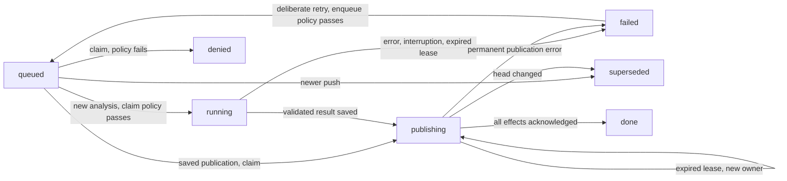

# Controller

Self-hosted Convex. Read the root `AGENTS.md` before changing the controller, and `docs/reference.html` before changing job, policy, or ledger contracts.

- `jobs` is the worker API. Every call authenticates `WORKER_SECRET` through `workerAuth.ts`, and every admin call `ADMIN_SECRET` through `adminAuth.ts`, both without early exit, like the webhook's `X-Gitlab-Token`. Ownership mutations require the current lease token. An expired owner cannot acknowledge publication. `lease.ts` grants, renews, and checks the leases of reviews and finding commands alike; add ownership rules there, not in a mutation.
- Vocabulary comes from `@fred/contracts`. Schema validators for its enums use `literals()` from `validators.ts`, so a literal set changes in one place.
- Claim serializes review jobs and human finding commands for the entire MR across providers in one Convex transaction. It returns the project's opened token, its bot user, and every former bot user; it is the only public function that returns a token. A project without a usable token fails the claimed review or command instead of leasing it. Only publication resumes after a lost worker. Expired analysis fails with a comment and incomplete accounting.
- Finding decisions append history and update disposition through `findingLifecycle`. The webhook stores a deduplicated finding-command receipt before returning HTTP 200. Scheduled verification checks current GitLab note authorship and effective membership, with bounded retries and attempt fencing before enqueue. Generic thread resolution has no lifecycle effect.
- Saved review publication carries a finding revision. Stale recovery reconciles an uncertain summary before supersession and cannot acknowledge obsolete resolutions or labels.
- Persist validated results before the first GitLab write. Keep result JSON immutable and acknowledge effects in order. Findings survive partial publication, failure, and supersession.
- `interruptAnalysis` resolves an ambiguous save response: it fails analysis and preserves publishing. Use it when the worker loses the connection during the transition.
- Usage inserts take nonnegative deltas and a stable observable event key. A replay with different amounts is an error. Final stage confirmations never clear an explicit incomplete flag.
- Delivery identity and review attempts are separate. `webhook-id` or `Idempotency-Key` identifies a retry. An outstanding review deduplicates the same provider and SHA. Fresh re-requests can rerun completed reviews. Remove/re-add retries failed reviews; saved publication reuses its job and effects under a new lease.
- The webhook looks up the project's FRED bot through `projectTokens.identity` and ignores projects that are not connected, with diagnostic reason `unconfigured`. Trigger detection reads `changes.reviewers` and `oldrev` for that one bot and returns at most one trigger. MRs authored by any project's FRED bot or `BOT_USER_IDS_OTHER` trigger only through a human, who owns the budget. Policy stays one pure function called at enqueue and new-analysis claim. Saved publication recovery checks its original budget owner at enqueue.
- Denial and failure notes use the existing durable `mrNotes` delivery mechanism and post as the project's FRED bot, including notes about retired-bot jobs. `noteKeys.ts` builds every delivery key: one comment per denial, and one per failed lease generation of a review or finding command. `denyReview` is the one denial path for enqueue and claim. An unconnected project fails delivery without retry. Worker publication uses its saved effects and acknowledgements.
- GitLab REST calls stay in `gitlab*.ts`. `gitlabRest.ts` is the one client: ten-second timeout, redirects rejected so the token never leaves `GITLAB_URL`, and the retryable statuses and retry delays. `gitlabApi.ts` delivers notes, `gitlabTokens.ts` inspects tokens and creates labels, and `gitlabVerification.ts` verifies finding command notes.
- The budget gate reads the developer's `usageMonthly` row through `by_developer_month`; month and day are written in the org timezone when each usage row is inserted. The admin spend query reads the `usageDaily` and `usageMonthly` rollups, never the ledger.
- `savedResult()` in `reviewOutcomes.ts` is the one reader of `resultJson`, and `findingCounts()` the one finding count. A result that no longer parses throws, except in `diagnostics:inspect`, which flags it.
- `reviewFailures` is append-only. Every job failure, claim denial, enqueue-time denial, and permanently failed comment appends one row through `reviewFailures.ts`. Recovery clears the job's failure fields, never the ledger.
- `admin` exposes queries and the project writes behind `ADMIN_SECRET`: `projects`, `connectProject`, `checkProject`, `savePipeline`, `disconnectProject`, and `refreshModels`. Connecting checks the token with GitLab, creates missing `fred-review::` labels, seals the token, and sets the bot's avatar from `botAvatar.ts` without failing the connect when GitLab refuses it. Reject unsupported pipelines and stale `pipelineRevision`s. Snapshot the project's pipeline at enqueue; fresh analysis retries use the current pipeline, while publication recovery preserves the original job. Admin functions never return a sealed or plaintext token. Admin authentication grants no worker or diagnostics access.
- `projectTokens` holds one sealed token per connected project, AES-256-GCM under `FRED_TOKEN_KEY` with the GitLab project ID as authenticated data. Only `projectTokens.ts` opens tokens. `connection()` there is the one definition of a connected project, and `projectCredential()` treats an unreadable token as none. `projects.botUserIds` keeps every former bot user so replaced tokens still own their discussions.
- Provider `fred` is the only active bot. `claude` and `codex` stay in the schema as retired history; claim and `listQueued` never return their work, `migrations:retireLegacyQueue` retires it, and MR exclusion ignores it.
- Crons expire analysis leases, wake subscribers when publishing becomes recoverable, prune diagnostics, and recheck every project token with GitLab every six hours. Deployment targets self-hosted Convex only; configuration is in `self-hosted/`.
