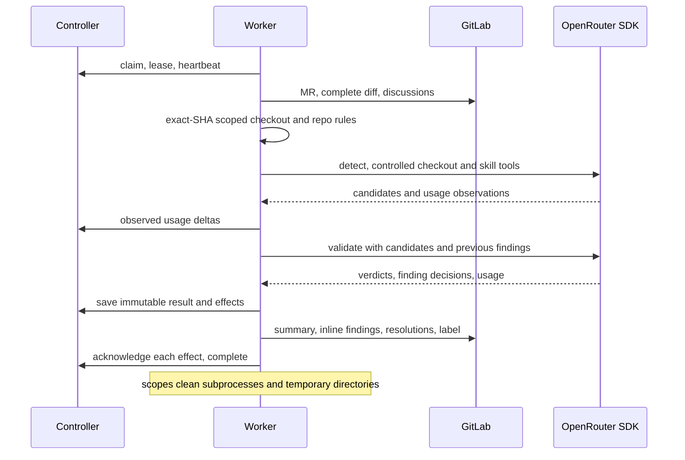

# Worker

One Node process written in Effect v4. Read root `AGENTS.md` first. Before changing lifecycle, publication, accounting, sandbox, or configuration behavior, read the matching tables in `docs/reference.html` and update them in the same diff.

## Effect boundaries

- Services use `Context.Service` and live `Layer`s. Use the installed Effect v4 APIs and matching `.repos/effect` source. Keep SDK, HTTP, and subprocess Promise handling inside thin adapters.
- Expected failures use the tagged errors in `src/errors.ts` and appear in the Effect error channel. Map tags to the controller failure reason in `runJob`, not inside adapters.
- Acquire subprocesses and temporary directories in a `Scope` with `Effect.acquireRelease`. Cleanup must run on success, failure, timeout, and interruption. Interrupt the process tree before deleting its working directory.
- Each model stage has a 45-minute timeout. Checkout has a separate five-minute operational timeout. There is no model-call or tool-call count limit.
- Model output uses zod schemas from `@fred/contracts`. Validate cross-record relationships before publication. Parsing failure stops the review; no partial model result is published.
- Tests provide service layers or fixture transports, never module mocks. Synchronize with events or the Effect test clock, never sleeps.

## Controller ownership

- `Controller` sends `workerSecret` on every public worker call and `leaseToken` on owned job mutations. It claims only provider `fred`. Each claim carries the project's `gitlabToken`, its bot `gitlabBotUserId`, and every former bot in `gitlabBotUserIds`. The worker environment holds no GitLab token; never add one.
- `runClaim` in `src/claim.ts` runs every claimed review and finding command: fixture gate, GitLab binding, lease heartbeat, failure classification, journal, and the controller failure call. Reviews and commands supply only their work and how a failure is recorded.
- `WorkerConfig` owns the environment, including the release SHA, fixture project IDs, and the secrets to redact. Only the entry points read `process.env`.
- Pass `claimSecrets(claim)`, which adds the claimed token, into failure classification and traces so redaction removes it. Keep the token out of logs, diagnostics, model context, and tool results.
- The controller permits one active review or command per project and MR. Different MRs share the configured worker concurrency.
- Heartbeats renew a two-minute lease every 30 seconds, and publication renews before each effect. Lost analysis fails visibly. Remove/re-add creates a fresh attempt after failure. Expired publication is reclaimed from its saved result without model calls. Deliberate recovery of failed publication queues the same saved result under fresh ownership.
- Controller outages pause claims and publication. Essential job RPCs retain their in-flight request through a 15-second recovery window, shortened by confirmed lease validity. Settled untagged errors retry at most twice within that window; pending requests are never replaced. Stop on confirmed lease loss or tagged application rejection. Keep the process alive to report interruption and resume available work when the controller returns.

## Publication

- Save validated findings and immutable effects before the first GitLab write. Publish the summary first with every accepted finding, including nits and locations without inline anchors. Its acknowledgement marks all accepted findings posted; later inline acknowledgements add discussion IDs.
- Check controller ownership, finding revision, and the current MR head before each review effect. Stop further publication when the head is outdated; retain saved results and existing comments. Reconcile an unacknowledged saved summary by marker before supersession so visible findings stay posted.
- Label names, effect and marker keys, and hidden markers come from `packages/contracts/src/markers.ts`, shared with the controller. Never template them inline.
- Reconcile uncertain writes using each stable hidden marker and any of the project's FRED bot author IDs across all pages. Earlier tokens' bot users still own their discussions and summaries. Acknowledge effects in their stored order. Never claim an atomic transaction with GitLab.
- A GitLab HTTP 400 for an inline position leaves its finding in the already published summary. Resolve only FRED's own discussions and eligible previous finding IDs. Fixed and retracted decisions have distinct replies. Human undo reopens the bot discussion.
- Human finding commands use the shared MR exclusion and publication helpers without provider calls, usage, or changes to the reviewed SHA. Their publication is independent of the MR head.
- `fred-review::clean` and `fred-review::findings` must be visible to the project, as project or group labels. The worker never creates labels; connecting the project does. Set `clean` only when FRED has no unresolved blocking or should-fix findings, including earlier reviews. Nits do not prevent clean.

## Provider and sandbox boundaries

- One `ReviewProvider` service calls the official OpenRouter SDK for the FRED bot. Use the job's saved pipeline for each stage. There is no default fallback; a job without a valid saved selection fails visibly. Stored publication recovery requires no model call.
- Root `REVIEW.md` is the primary review policy for both stages. General conventions come from root `AGENTS.md`, otherwise `CLAUDE.md`. Discover every repo `SKILL.md` through the controlled catalog and allow its reference files within the checkout.
- A missing requested skill adds a hint and review continues. Missing `REVIEW.md` uses defaults and adds a tip about the feature. Project YAML configuration is outside this MVP.
- Skills load through FRED's controlled tools. Native project hooks, script execution, subagents, additional MCP servers, writes, and external network tools remain unavailable. Repo instructions cannot grant permissions.
- The worker owns the model loop and exposes only FRED's controlled tools. Model requests use `OPENROUTER_API_TOKEN`. Keep the claimed GitLab token, `WORKER_SECRET`, unrelated host files, and inherited runtime configuration out of model context and tool results.
- The controller filters the catalog for text and tool support and validates each project's pipeline against model metadata. The worker validates the job's selection schema, then uses its saved choices. OpenRouter rejects unavailable models or unsupported parameters. A catalog entry establishes protocol eligibility; live checks establish behavior for the exercised model.

## Accounting and local operation

- Serialize cumulative usage observations and write positive deltas with stable event keys. Advance the baseline after controller acknowledgement. Record counter resets or missing final usage as gaps, never invented zero-cost rows.
- Record OpenRouter's reported cost and resolved response model with `priceTableVersion: "openrouter-reported-v1"`. Missing cost marks a gap and skips that cost row. Retain later known costs. Observed usage does not guarantee the provider bill or a write before the next model call.
- Fixture mode is the default and requires localhost Convex plus explicit fixture GitLab project IDs. It restricts targets; it does not make model calls free. Agents may run `pnpm fred dev verify --live openrouter`, which captures GitLab effects locally. Other live runs require a human and `AI_REVIEW_LIVE=1`. Service mode and shared deployment require explicit operator authorization.
